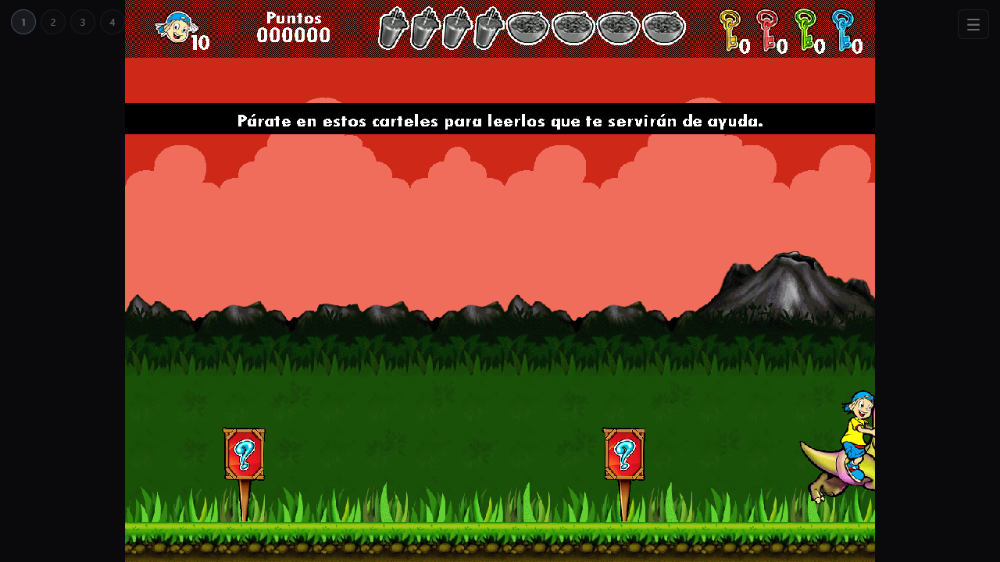

# XO original con CheerpX y dispositivos SDL del navegador

## Qué ejecuta

El ELF x86 original de `Vascolet1_MaquinadelTiempo.xo`. El SHA-256 del ELF y del
paquete fuente están registrados en `native/cheerpx/sources.json`. El código
del juego, sus mapas, sus reglas y sus recursos no se reescriben.

CheerpX ejecuta el código de Linux mediante su JIT x86 → WebAssembly. Un adaptador
SDL 1.2 reemplaza los dispositivos de vídeo, teclado, ratón y audio de Linux:
los sprites se dibujan con Canvas y el audio se reproduce con Web Audio. Las
operaciones gráficas se agrupan por cuadro para evitar miles de cruces de E/S
y mantener los controles HTML de la página responsivos.

No se inicia Wine, Direct3D ni un servidor X. El SDL nativo restante trabaja
con superficies de memoria y un dispositivo de vídeo dummy.

## Resultado verificado

Prueba local en Chromium y el mismo equipo con AMD Radeon RX 6500 XT:

| Medición | Resultado |
|---|---:|
| Arranque local, entorno nuevo | 3,8–6,0 s |
| Arranque local, entorno conservado | 2,2–2,3 s |
| Media dentro de La Prehistoria, con movimiento y salto | 58,0 FPS |
| Tiempo mediano entre cuadros | 17,1 ms |
| Percentil 95 de tiempo entre cuadros | 23,8 ms |
| Audio | AudioContext en ejecución, señal RMS distinta de cero |
| Guardado | Escritura, importación, reinicio y exportación verificados |

El benchmark comprueba primero la aparición del HUD del nivel. No utiliza una
pantalla de menú o de historia como sustituto de una partida. La medición de
movimiento duró unos 20 segundos. La primera descarga desde Internet puede
tardar más que la prueba local. No se ha certificado cada nivel ni cada equipo.

El reporte completo está en [cheerpx-benchmark.json](cheerpx-benchmark.json).

## Interfaz y partidas

Se usa la misma página y el mismo menú. `Automático` selecciona CheerpX en este
repositorio cuando el navegador tiene aislamiento de origen. También se puede
elegir `XO · CheerpX (experimental)` explícitamente. Los modos Wine se conservan
para comparar o recuperar una partida anterior de Windows.

Los datos XO viven en IndexedDB, en un espacio distinto del de Wine. El ejecutable
original guarda bajo `SUGAR_ACTIVITY_ROOT`. La copia JSON lleva un campo `engine`
para impedir que se importe accidentalmente en el motor de otra plataforma.

Por ahora esta integración se habilita solamente en Vascolet 1. Los otros tres
juegos requieren pruebas específicas; no se extrapolan estos resultados.

## Archivos y reproducción

- `site/cheerpx/bundle.zip`: bibliotecas, ELF original, assets y adaptadores.
- `native/cheerpx/sdl_bridge.c`: dispositivos SDL del navegador.
- `native/cheerpx/native_init.c`: preparación del sistema de archivos y copias.
- `native/cheerpx/mixer_anchor.c`: resolución de los símbolos de SDL_mixer.
- `site/cheerpx/bridge.js`: vídeo, entrada y Web Audio en el navegador.
- `site/cheerpx/launch.js`: CheerpX, persistencia e integración con el menú.
- `native/cheerpx/rebuild.py`: recompilación con Zig 0.13.0.

`python build.py` prepara el sitio estático sin necesitar un compilador. Para
reconstruir los adaptadores, configurar `ZIG` y ejecutar
`python native/cheerpx/rebuild.py`. Las opciones de compilación y hashes están en
`native/cheerpx/sources.json`. Los avisos y enlaces al código fuente de las
bibliotecas de terceros están incluidos dentro del bundle, en `licenses/`.

CheerpX 1.2.8 se carga desde su CDN oficial; no se redistribuye su runtime.
Documentación: https://cheerpx.io/docs/overview
